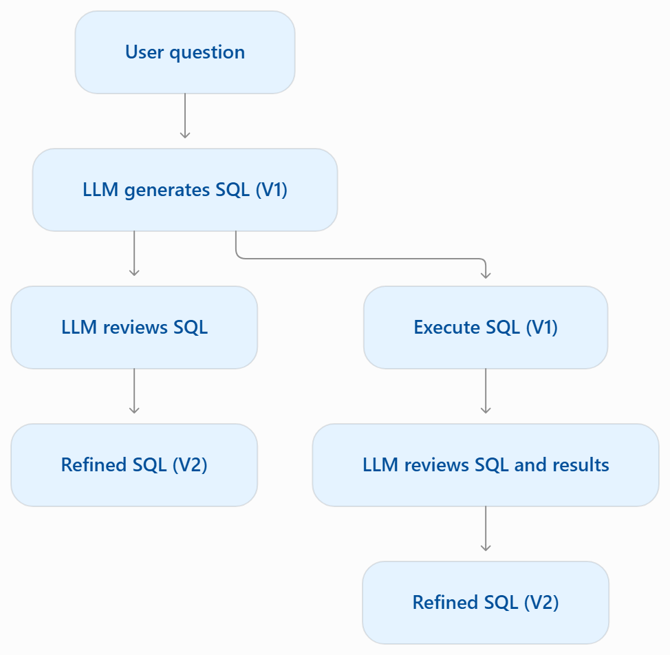
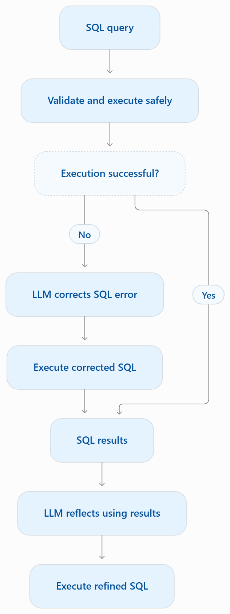

# Agentic SQL Assistant: SQL Generation, Reflection and Error Recovery

A Python project exploring how Large Language Models (LLMs) can generate, execute and improve SQL queries using execution feedback and reflection.

The project builds on the **Agentic AI course by DeepLearning.AI** and extends its SQL reflection exercise with database safety mechanisms and error-recovery experiments.

## Project Overview

This repository contains two Jupyter notebooks:

| Notebook | Description |
|---|---|
| `sql_reflection.ipynb` | Compares SQL reflection with and without execution feedback. |
| `agentic_sql_assistant.ipynb` | Extends the experiment with read-only SQL execution, error correction and reflection informed by database business rules. |

Both notebooks use OpenAI models and a local SQLite database containing simulated product transactions.

## 1. SQL Reflection

The first notebook investigates whether an LLM can identify and correct logical errors in generated SQL queries.



Two approaches are compared:

- **Without execution feedback:** The LLM evaluates the SQL query using the user question and database schema.
- **With execution feedback:** The LLM also receives the actual database results.

In the initial experiment, reviewing SQL alone failed to identify an incorrect sales calculation. Providing execution results helped the LLM recognise and correct the error.

## 2. Agentic SQL Assistant

The second notebook extends the reflection experiment by introducing database safety and SQL error correction.



The notebook demonstrates:

- **SQL safety:** Basic query validation, read-only SQLite connections and a SQLite authoriser.
- **Error recovery:** Using database error messages to correct invalid SQL.
- **Reflection:** Reviewing query results to identify logical errors.
- **Domain knowledge:** Improving SQL generation by providing business rules that describe the database.

The experiments demonstrate that correcting execution errors does not necessarily produce logically correct SQL. Execution feedback and relevant domain knowledge can improve query quality.

The notebook currently demonstrates these steps sequentially rather than implementing a fully autonomous retry loop.

## 3. Database

The project uses SQLite, requiring no separate database server.

The `products.db` database contains a `transactions` table with simulated product events, including initial stock, restocking, sales and price updates.

Sales are represented by negative quantity changes (`qty_delta`), making revenue calculations a useful test of SQL reasoning.

## 4. Installation and Usage

**Requirements:** Python 3.12 and an OpenAI API key.

1. Clone the repository.
2. Create and activate a Python environment.
3. Install the dependencies:

   ```bash
   pip install -r requirements.txt
   ```

4. Create a `.env` file in the project directory:

   ```text
   OPENAI_API_KEY=your_api_key_here
   ```

5. Open either notebook in VS Code or Jupyter and run the cells sequentially.

The `.env` file is excluded from Git to protect API credentials.

OpenAI API usage may incur charges.

## 5. Key Findings

- Syntactically valid SQL can produce logically incorrect results.
- SQL execution feedback provides useful evidence for reflection.
- Error correction does not guarantee query correctness.
- Database-specific business rules can improve LLM reasoning.
- Read-only database controls help protect against unintended modifications.

**Limitations:** LLM reflection does not guarantee correctness. The current implementation does not provide autonomous multi-iteration refinement, independent answer verification or comprehensive protection against arbitrary untrusted SQL.

## Acknowledgement

This project was inspired by the *Agentic AI* course from **DeepLearning.AI**. The original SQL reflection exercise provided the starting point for further experimentation with SQL safety, error recovery and domain-informed reflection.